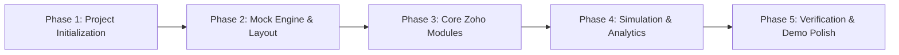

# Frontend UI Execution Plan & Specification: LeadA360 Campaign
**Project Title:** LeadA360 Campaign — In-House Email Marketing Platform (Zoho Campaigns Equivalent)  
**Submission Goal:** Standalone, Interactive React UI Submission  
**Backend Requirement:** Zero (100% Client-Side Interactive Mock Architecture)  
**Target Showcase Capacity:** 300,000 Emails / Day (~9M Emails / Month)  
**Reference Documents:** [`PROJECT_EXECUTION_PLAN_FOR_MANAGEMENT.md`](./PROJECT_EXECUTION_PLAN_FOR_MANAGEMENT.md), [`SYSTEM_DESIGN.md`](./SYSTEM_DESIGN.md)

--

## 1. Executive Summary & UI Submission Strategy

### 1.1 Objective
To deliver a fully functional, high-fidelity **Zoho Campaigns alternative** web application built with **React**, specifically designed for tomorrow's management review and UI demonstration.

### 1.2 Zero-Backend Standalone Architecture
For tomorrow's submission, the user interface will operate independently of a live Django/PostgreSQL backend:
* All platform data (campaigns, subscriber lists, deliverability logs, telemetry events, and workflows) will be driven by a robust, reactive **Mock Data Engine** conforming strictly to the PostgreSQL schema defined in `SYSTEM_DESIGN.md`.
* State alterations (creating a new campaign, importing CSV contacts, running automated journeys, modifying templates, and launching bulk dispatches) will be handled reactively via **React Context & Local Storage**, enabling reviewers to experience an active, working product.

### 1.3 Key Evaluator Highlights
1. **Zoho Campaigns Parity:** Comprehensive workflow coverage spanning audience segmentation, campaign creation, drag-and-drop template editing, and multi-channel reports.
2. **LeadA360 Technical Moat:** Dedicated screens showcasing enterprise AWS SES delivery, real-time 1,000-batch chunking visualization, SPF/DKIM/DMARC compliance verification, and 30-Day IP Warmup progress tracking.

---

## 2. Technology Stack & Design System

| Layer | Technology | Purpose & Business Value |
| :--- | :--- | :--- |
| **Framework & Bundler** | **React 18 / 19 + Vite** | Instant build performance, modular component architecture, and rapid hot reloading. |
| **Styling & Theme** | **Tailwind CSS** | Professional enterprise SaaS design system with Zoho-style clean navigation, tables, badges, and modals. |
| **Iconography** | **Lucide-React** | Consistent, modern iconography across all menus, actions, and status indicators. |
| **Data Visualization** | **Recharts** | Interactive charts for 24-hour engagement curves, delivery success rates, and link click distributions. |
| **State Management** | **React Context API** | Centralized application state for campaigns, contacts, templates, and active simulation pipelines. |

---

## 3. Directory Structure (`/frontend`)

The frontend code will be organized inside a dedicated `/frontend` root directory:

```
d:\LEADA360-CAMPAIGN\frontend\
├── index.html
├── package.json
├── vite.config.js
├── tailwind.config.js
├── postcss.config.js
└── src\
    ├── assets\                     # Application logos, demo templates, avatars
    ├── mockData\                   # Mock data matching SYSTEM_DESIGN.md models
    │   ├── campaigns.js            # Campaigns (Draft, Scheduled, Processing, Sent)
    │   ├── contacts.js             # Subscribers, lists, custom tags, and suppression data
    │   ├── templates.js            # Responsive email templates (Promos, Newsletters, etc.)
    │   ├── analytics.js            # Hourly opens, click heatmaps, geo stats, device metrics
    │   └── workflows.js            # Visual automation nodes, triggers, and delay logic
    ├── context\
    │   ├── CampaignContext.jsx     # Campaign creation, status updates, and dispatch runner
    │   └── ContactContext.jsx      # Contact CRUD, list filtering, and CSV import handling
    ├── components\
    │   ├── layout\
    │   │   ├── Sidebar.jsx         # Collapsible Zoho-style enterprise navigation sidebar
    │   │   ├── Topbar.jsx          # Tenant branding, SES health indicators, alerts, profile
    │   │   └── MainLayout.jsx      # Primary layout wrapper
    │   ├── common\                 # Reusable UI primitives
    │   │   ├── StatCard.jsx        # KPI metric cards with trend indicators
    │   │   ├── StatusBadge.jsx     # Status chips (ACTIVE, BOUNCED, COMPLAINED, SENT)
    │   │   ├── DataTable.jsx       # Interactive tables with search, filter, pagination
    │   │   └── Modal.jsx           # Reusable modal dialogs
    │   ├── campaign-wizard\        # 5-step Zoho Campaign Creation flow
    │   │   ├── Step1Details.jsx    # Campaign name, subject, preheader, sender address
    │   │   ├── Step2Audience.jsx   # List targeting, segments, suppression filtering
    │   │   ├── Step3Template.jsx   # Curated template gallery picker
    │   │   ├── Step4Builder.jsx    # Visual email editor & responsive preview
    │   │   └── Step5ReviewSend.jsx # SPAM test score, audit checklist, schedule / send
    │   └── simulation\
    │       └── DispatchSimulator.jsx # Real-time visual worker chunking (300k in 1k batches)
    └── pages\
        ├── Dashboard.jsx           # Executive overview, delivery telemetry, quick actions
        ├── Campaigns.jsx           # All campaigns management table & status filters
        ├── CampaignDetail.jsx      # Deep-dive campaign report (Heatmaps, 24-hr curves)
        ├── EmailBuilder.jsx        # Dedicated fullscreen visual drag-and-drop builder
        ├── Contacts.jsx            # Subscriber directory, Lists, Segments, Custom attributes
        ├── CSVImportModal.jsx      # Drag-and-drop CSV upload with column auto-mapper
        ├── SuppressionList.jsx     # Hard bounces, spam complaints, and unsubscribe blacklist
        ├── Automation.jsx          # Visual customer journey & autoresponder builder
        ├── Templates.jsx           # Email template library & responsive viewer
        └── Deliverability.jsx      # AWS SES DNS status (SPF/DKIM/DMARC) & IP Warmup Tracker
```

---

## 4. Detailed Specification of the 7 Zoho Campaigns Modules

### Module 1: Executive Dashboard & Overview
* **Primary KPI Cards:**
  * **Total Emails Sent:** 2,840,000 (with month-over-month growth trend)
  * **Average Delivery Rate:** 98.7% (highlighting SES high deliverability)
  * **Average Open Rate:** 24.3% (industry standard: ~20%)
  * **Average Click-Through Rate:** 4.1%
  * **Bounce Rate:** 0.38% (well below the 0.5% safety threshold)
  * **Spam Complaint Rate:** 0.04% (strictly below the 0.1% Google/Yahoo cap)
* **Visual Charts:**
  * 7-day sending volume vs deliverability rate (Dual-axis Recharts area/line chart).
  * Mail client distribution (Gmail 54%, Apple Mail 22%, Outlook 16%, Others 8%).
* **Quick-Action Shortcuts:**
  * "+ Create Campaign" (launches 5-step wizard)
  * "Import Contacts" (launches CSV mapper)
  * "Inspect Deliverability" (navigates to SES health)

### Module 2: Campaigns Management & 5-Step Creation Wizard
* **Campaign Directory Views:**
  * Filter tabs: `All`, `Drafts`, `Scheduled`, `Processing (Live)`, `Sent`, `A/B Testing`.
  * Table columns: Campaign Name, Status Badge, Target List, Recipients, Open Rate %, Click Rate %, Last Modified, Actions.
* **The 5-Step Zoho Campaign Wizard:**
  1. **Step 1: Campaign Details:**
     * Campaign Title (Internal identification)
     * Email Subject Line (Supports dynamic merge tags like `{{first_name}}`)
     * Preheader Text (Snippet shown in mailbox preview)
     * Sender Name & Verified Sender Email (`marketing@leada360.com`)
     * Custom Reply-To address
  2. **Step 2: Audience Selection:**
     * Select Target Lists (e.g. "Q4 High-Value Leads", "Enterprise Contacts")
     * Dynamic Segments filter
     * Exclude Suppression List toggle (enforces compliance)
     * Real-time active recipient counter calculation
  3. **Step 3: Template Chooser:**
     * Categorized gallery: Newsletters, Product Launches, Promotional Offers, Event Invites.
     * Option to start from blank canvas or import custom HTML.
  4. **Step 4: Visual Email Builder & Preview:**
     * Interactive preview pane with toggle between **Desktop (600px)** and **Mobile (375px)** views.
     * Content blocks: Header Logo, Hero Banner, Dynamic Heading, Text Body, Call-to-Action Button, Social Icons, RFC 8058 1-click unsubscribe legal footer.
  5. **Step 5: Review, Audit & Dispatch:**
     * Pre-flight checklist: Subject Check (Passed), Sender Verification (Verified), Audience Count (Calculated), Suppression Check (Cleared).
     * SPAM Score Predictor (e.g. `0.2 / 10 - Excellent Deliverability`).
     * Dispatch Action: Send Immediately or Schedule for specific Date/Time.
* **Live Dispatch Simulation Engine:**
  * For live presentations: Users can click **"Simulate Live 300,000 Dispatch"**.
  * Shows animated real-time dispatch progress:
    * Chunks 300,000 recipients into 300 micro-batches of 1,000.
    * Visual worker queue showing parallel Celery dispatches at 25 emails/sec.
    * Live counters for Sent, Delivered, and Transient Retries.

### Module 3: Deep Campaign Analytics & Telemetry Report
* **Campaign Summary Scorecard:**
  * Total Dispatched, Delivered, Unique Opens, Unique Clicks, Unsubscribes, Bounces.
* **24-Hour Telemetry Timeline:**
  * Recharts area chart tracking open and click velocity from hour 0 to hour 24 after broadcast.
* **Link Click Heatmap & Distribution:**
  * Table listing every link embedded in the email:
    * Destination URL, Click Count, Unique Clickers, Click Percentage share.
* **Granular Recipient Activity Feed:**
  * Searchable table of individual contacts with timestamps:
    * `alex.smith@company.com` — Opened (10:14 AM) — Clicked `https://leada360.com/demo` (10:16 AM)
    * `priya.patel@techcorp.in` — Delivered (09:02 AM) — Opened (11:45 AM)
    * `jordan.lee@invaliddomain.xyz` — Bounced (Hard Bounce: Mailbox does not exist)

### Module 4: Contacts & Audience Management
* **Subscribers Directory:**
  * Filter by Status (`ACTIVE`, `UNSUBSCRIBED`, `BOUNCED`, `COMPLAINED`), Source, Created Date.
  * Search by email, name, or company.
* **List & Segment Manager:**
  * Create custom lists (e.g. "SaaS Decision Makers", "Bangalore Tech Summit").
  * Segment builder based on engagement (e.g. `Opens > 3 in last 30 days`).
* **CSV Import Wizard:**
  * Drag-and-drop file dropzone (`.csv`, `.xlsx`).
  * Auto-column mapping interface:
    * CSV Header `Email Address` $\rightarrow$ System Attribute `email`
    * CSV Header `First Name` $\rightarrow$ System Attribute `first_name`
    * CSV Header `Company Name` $\rightarrow$ System Attribute `attributes.company`
  * Duplicate handling setting: *Skip duplicates* or *Update existing attributes*.
* **Global Suppression List:**
  * Dedicated registry displaying permanently blocked emails (Hard Bounces, User Complaints, Unsubscribes).
  * Prevents accidental dispatches, protecting domain health.

### Module 5: Visual Automation & Customer Journeys
* Visual workflow canvas illustrating automated drip sequences:
  * **Trigger:** Contact joins list "New Website Signups".
  * **Step 1:** Send "Welcome & Getting Started Guide" (Immediate).
  * **Step 2:** Delay / Wait 2 days.
  * **Step 3 (Condition Branch):** Did contact open the welcome email?
    * **If Yes:** Send "Product Demo Invitation".
    * **If No:** Send "Gentle Reminder: Quick Tips to Get Started".
* Pre-built automation templates (Welcome Series, Inactive Re-engagement, Event Countdown).

### Module 6: Template Library
* Curated responsive email designs:
  * Executive Product Announcement
  * SaaS Feature Release Notes
  * Weekly Industry Digest
  * Black Friday / Seasonal Offer
* Template preview modal with dynamic personalization preview (`Hello Priya` vs `Hello {{first_name}}`).

### Module 7: Deliverability & Amazon SES Health Center (Management Value Showcase)
* **Domain Authentication Dashboard:**
  * SPF Record: `v=spf1 include:amazonses.com ~all` — **VERIFIED (Green Check)**
  * DKIM Record: 3 CNAME 2048-bit keys — **VERIFIED (Green Check)**
  * DMARC Record: `v=DMARC1; p=quarantine; pct=100` — **VERIFIED (Green Check)**
  * Custom MAIL FROM Domain: `mail.leada360.com` — **ACTIVE (Green Check)**
* **30-Day IP Warmup Schedule Tracker:**
  * Visual progress stepper:
    * Week 1: 5k – 15k emails/day (Completed)
    * Week 2: 30k – 60k emails/day (Current Stage: 60,000 / day cap)
    * Week 3: 100k – 180k emails/day (Upcoming)
    * Week 4: Full 300,000 emails/day scale (Target)
* **ISP Reputation Monitor:**
  * Google Postmaster spam rate gauge: `0.03%` (Threshold: `< 0.10%`)
  * SES Sending Quota: `100 emails/second`

---

## 5. Execution Roadmap



1. **Phase 1: Project Initialization:**
   * Initialize React + Vite application inside `/frontend`.
   * Configure Tailwind CSS and install `lucide-react` and `recharts`.
2. **Phase 2: Mock Engine & Layout:**
   * Create mock data models matching `SYSTEM_DESIGN.md`.
   * Implement Zoho-style collapsible sidebar, topbar with SES health pill, and context providers.
3. **Phase 3: Core Zoho Modules:**
   * Build Dashboard, Campaigns table, Contacts table with CSV modal, and Template gallery.
   * Implement the 5-step Campaign Creation Wizard.
4. **Phase 4: Simulation & Analytics:**
   * Implement Campaign Analytics report with Recharts and click heatmaps.
   * Add the Live 300k Dispatch Simulation Engine widget.
   * Build Deliverability & IP Warmup tracker.
5. **Phase 5: Verification & Demo Polish:**
   * Execute build test (`npm run build`) to ensure zero errors.
   * Verify all navigation, filters, modals, and interactive flows.

