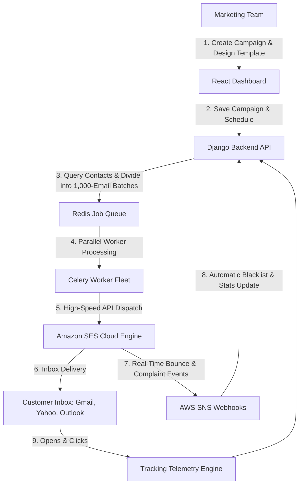
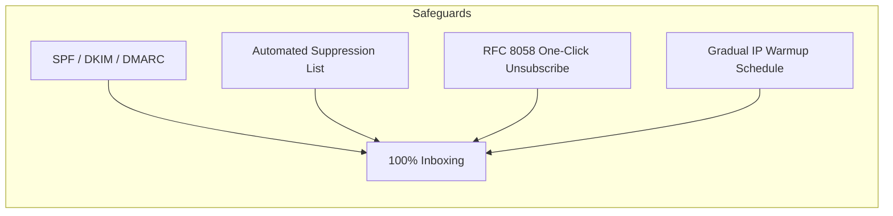

# Project Execution Plan & Technical Strategy: LeadA360 Campaign
**Project Title:** In-House Email Marketing & Delivery Platform (Zoho Campaigns Alternative)  
**Target Delivery Scale:** 3 Lakhs (300,000) Emails / Day (~9 Million Emails / Month)  
**Audience:** Management, Project Leads & Technical Stakeholders  
**Tech Stack:** React (Frontend), Python / Django REST Framework (Backend), Celery + Redis (Queue), Amazon SES (Delivery)

---

## 1. Executive Summary

### 1.1 The Objective
The goal of this project is to build a modern, high-throughput, self-hosted email marketing platform (**LeadA360 Campaign**) functionally equivalent to commercial platforms like **Zoho Campaigns** or **Mailchimp**. 

The platform will allow marketing teams to:
1. Maintain and segment contact lists with custom attributes.
2. Design responsive marketing templates via a drag-and-drop builder.
3. Schedule and broadcast bulk campaigns of **300,000 emails per day**.
4. Track real-time engagement (opens, link clicks, unsubscribes).
5. Safeguard domain reputation with automatic bounce, complaint, and suppression management.

### 1.2 Business Justification & ROI (Why Build vs. Buy?)

| Metric | Commercial SaaS (e.g. Zoho / Mailchimp) | In-House LeadA360 (AWS SES) |
| :--- | :--- | :--- |
| **Pricing Model** | Charged per contact stored (even if unsent) | Pay-as-you-go strictly for emails dispatched |
| **Estimated Monthly Cost (9M emails)** | **$2,500 – $4,500+ / month** | **~$1,240 / month** ($900 AWS SES + $340 Infra) |
| **Annual Savings** | — | **$15,000 – $38,000+ saved per year** |
| **Data Privacy & Ownership** | Customer data resides on third-party cloud | 100% internal control, compliance with GDPR/DPDP |
| **Custom Workflows** | Limited to SaaS platform capabilities | Unlimited customization & deep CRM integrations |

---

## 2. High-Level Technical Architecture (In Simple Terms)

To the end user, this application feels like a smooth, visual dashboard. Under the hood, it operates across four decoupled layers:



1. **The User Interface (React):** A clean, responsive dashboard with contact upload, audience segmentation, drag-and-drop template designer, and real-time visual analytics.
2. **The Brain (Django REST Framework):** Manages users, permissions, contacts, campaign definitions, and coordinates background workers.
3. **The Engine (Celery + Redis):** Breaks large 300,000-contact lists into micro-batches of 1,000 recipients, queuing them across parallel workers so the server never freezes or crashes.
4. **The Pipe (Amazon SES v2):** Handles the physical transmission of emails to global internet service providers (ISPs) at 25–30 emails per second.

---

## 3. How the Team Will Work (Engineering Methodology)

### 3.1 Agile Sprints & Review Cycles
* **Sprint Cadence:** 2-week agile sprint cycles.
* **Sprint Planning & Demo:** Every alternate Monday begins with sprint goals; every second Friday ends with an interactive manager demo of working software.
* **Continuous Tracking:** Tasks tracked on Jira / Linear with clear acceptance criteria for every ticket.

### 3.2 Code Quality & CI/CD Pipeline
* **Repository Architecture:** Monorepo or clean two-service repo (`/frontend` React and `/backend` Django).
* **Git Branching:** Git-Flow (`main` -> `staging` -> `feature/ticket-name`). No direct commits to `main`.
* **Automated Quality Checks:**
  * Backend: Automated `pytest`, `flake8`, and type-checking via GitHub Actions.
  * Frontend: `ESLint`, `Prettier`, and build validation before pull requests are approved.
* **Environments:**
  * **Local:** Docker Compose setup replicating DB, Redis, and Celery locally.
  * **Staging:** Connected to AWS SES Sandbox for safe test sends without affecting production domains.
  * **Production:** Production-grade AWS environment with dedicated IPs and custom sender domains.

---

## 4. 10-Week Project Roadmap & Delivery Milestones

```mermaid
gantt
    title LeadA360 Campaign Project Delivery Timeline
    dateFormat  YYYY-MM-DD
    section Phase 1: Core Foundation
    DB Models & Multi-Tenant Setup     :p1_1, 2026-11-09, 7d
    Contact Management & CSV Importer   :p1_2, after p1_1, 7d
    section Phase 2: Campaign Builder
    MJML Drag-and-Drop Builder UI      :p2_1, after p1_2, 8d
    Campaign Creation & Personalization:p2_2, after p2_1, 6d
    section Phase 3: SES & Queue Engine
    Celery Batch Chunker & Queue Engine:p3_1, after p2_2, 7d
    Amazon SES v2 API Integration      :p3_2, after p3_1, 7d
    section Phase 4: Telemetry & Safety
    Click & Open Tracking Engine       :p4_1, after p3_2, 7d
    SNS Webhooks & Auto-Suppression    :p4_2, after p4_1, 7d
    section Phase 5: Warmup & Launch
    Load Stress Testing (300k Batch)   :p5_1, after p4_2, 5d
    Domain DNS & IP Warmup Strategy    :p5_2, after p5_1, 5d
    Production Go-Live                 :milestone, after p5_2, 0d
```

### Detailed Phase Breakdown:

#### Phase 1: Architecture & Audience Management (Weeks 1 – 2)
* Setup PostgreSQL database schema with indexing and JSONB custom fields.
* Contact List Manager: Import/export large CSV files (up to 500,000 rows) using background streaming without memory spikes.
* Audience segmentation: Filter contacts by criteria (e.g., location, tag, engagement score).

#### Phase 2: Template Builder & Campaign Orchestration (Weeks 3 – 4)
* Integrate a visual drag-and-drop email builder (GrapeJS with MJML engine).
* Variable merge tags: Dynamic personalization (e.g., `Hello {{first_name}}`).
* Campaign scheduler: Ability to trigger immediate blasts or schedule for future dates/times.

#### Phase 3: High-Throughput Queue Engine & Amazon SES (Weeks 5 – 6)
* Celery worker fleet configuration with Redis message broker.
* Implement the **Chunking Algorithm**: Breaks 300k campaigns into 300 micro-batches of 1,000 recipients.
* Connect to Amazon SES v2 via `boto3` utilizing `SendBulkEmail` (50 emails per API call) or parallel connection pools.
* Rate limiter: Enforce strict rate caps to comply with AWS sending quotas.

#### Phase 4: Deliverability, Tracking & Telemetry (Weeks 7 – 8)
* Open tracking (1x1 transparent tracking pixel with HMAC signed tokens).
* Click tracking (URL wrapping with instant HTTP 302 redirects).
* AWS SNS Webhook Receiver: Automatically intercept bounced emails and spam complaints.
* Automated **Global Suppression List**: Automatically prevents sending to any address that bounced or complained.

#### Phase 5: Stress Testing, IP Warmup & Production Launch (Weeks 9 – 10)
* Synthetic stress test: Simulate 300,000 queued jobs in staging to benchmark worker throughput.
* Domain authentication verification: Setup SPF, DKIM (2048-bit), DMARC, and custom `MAIL FROM` domains.
* Execution of the **30-Day IP Warmup Plan** to establish high inbox delivery reputation on Gmail and Yahoo.

---

## 5. Deliverability & Risk Management (Crucial for Manager Awareness)

The single biggest operational risk in bulk email sending is **Landing in the Spam Folder** or getting your **AWS Account Paused**. We mitigate this with four strict engineering guardrails:



1. **New 2024 Google & Yahoo Sender Requirements:**
   * Gmail and Yahoo enforce that sender spam complaint rates **must stay below 0.1%** (never exceed 0.3%).
   * We implement **RFC 8058 One-Click Unsubscribe Headers** natively, allowing mailbox users to unsubscribe easily instead of clicking "Mark as Spam".
2. **Immediate Bounce & Complaint Lockout:**
   * Any email that hard-bounces or registers a spam complaint is automatically flagged and suppressed across all future campaigns instantly.
3. **Dedicated IP Warmup Protocol:**
   * We will **not** send 300,000 emails on Day 1 from a new IP. We will scale up gradually over 3 to 4 weeks:
     * **Week 1:** 5,000 – 15,000 emails/day (to your most active contacts).
     * **Week 2:** 30,000 – 60,000 emails/day.
     * **Week 3:** 100,000 – 180,000 emails/day.
     * **Week 4:** Full 300,000 emails/day capacity reached.

---

## 6. Team Roles & Resource Allocation

| Role | Core Responsibilities |
| :--- | :--- |
| **Backend & Pipeline Lead (Django/Celery)** | Database design, CSV processing, Celery queue architecture, Amazon SES API integration, and webhook ingestion. |
| **Frontend Lead (React)** | Dashboard UI, Audience tables, Campaign creation wizard, Drag-and-Drop MJML editor integration, and Analytics charts. |
| **DevOps / Deliverability Engineer** | AWS infrastructure setup (RDS, ECS/EC2, ElastiCache, SES, Route53, SNS), DNS records (SPF, DKIM, DMARC), and IP warmup monitoring. |
| **QA & Performance Engineer** | End-to-end integration tests, CSV edge cases, stress testing 300k queues, and email client rendering verification (Outlook, Gmail, iOS Mail). |

---

## 7. Key Performance Indicators (KPIs) for Success

To objectively measure project success, the management team can monitor the following metrics:

* **Dispatch Throughput:** System achieves **$\ge$ 25 emails/second** consistently without worker memory leaks.
* **Delivery Rate:** $\ge$ **98%** successful inbox delivery to verified contact lists.
* **Spam Complaint Rate:** Maintained strictly **$< 0.08\%$** (well under the 0.1% ISP threshold).
* **Tracking Latency:** Redirect click speed $< \mathbf{50ms}$ to ensure zero user friction.
* **Cost Efficiency:** Monthly sending and hosting infrastructure remains within **$1,200 – $1,300/month** at full 9M email capacity.

---

## 8. Summary & Next Immediate Steps

1. **Review & Sign-Off:** Review the technical design with management and technical leads.
2. **AWS Account Preparation:** Request production access and increase sending quota to 50–100 emails/second on Amazon SES.
3. **Repository Initialization:** Initialize the React frontend and Django backend structure in `d:\LEADA360-CAMPAIGN`.
4. **Sprint 1 Kickoff:** Commence database schema implementation and contact management modules.

