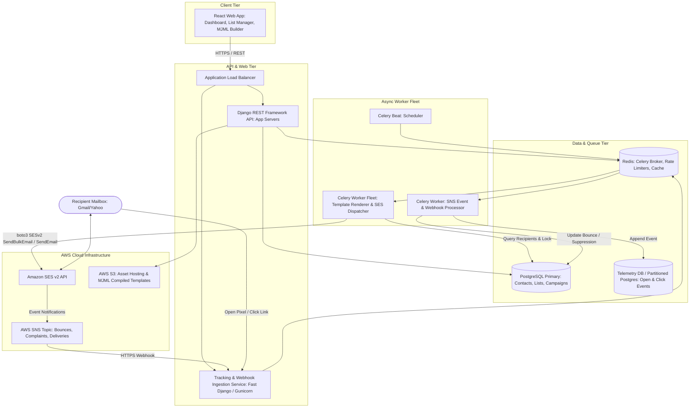
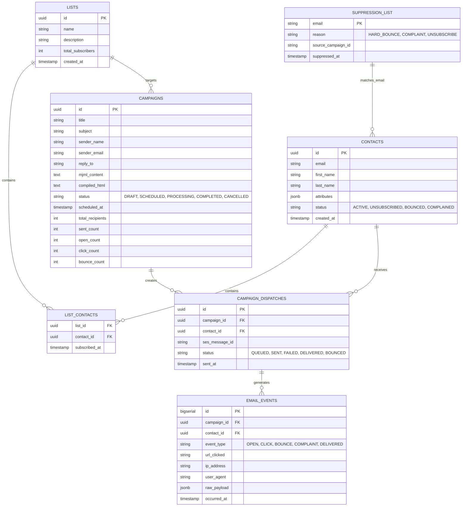
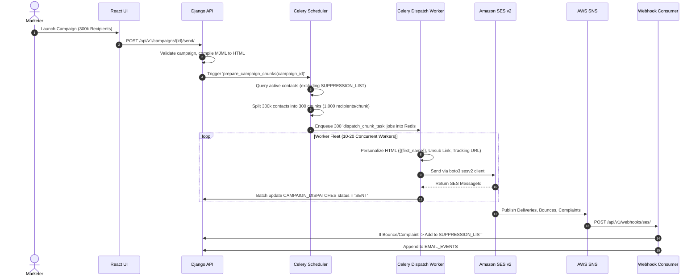

# System Design: Zoho Campaigns Clone (LeadA360 Campaign)
**Target Volume:** 3 Lakhs (300,000) Emails / Day (~9 Million / Month)  
**Core Stack:** React + Python (Django & Celery) + PostgreSQL + Redis + Amazon SES

---

## 1. System Requirements & Capacity Planning

### 1.1 Non-Functional Requirements & Throughput Sizing
* **Daily Volume:** 300,000 emails/day.
* **Peak Window:** 4 hours (e.g., 9:00 AM – 1:00 PM marketing blast).
* **Peak Hourly Rate:** $300,000 / 4 = 75,000\text{ emails/hour}$.
* **Throughput Required:**
  $$\frac{75,000}{3,600} \approx 20.8 \rightarrow \mathbf{25\text{ to }30\text{ emails/second}}.$$
* **AWS SES Quota Requirement:** Request a production quota of **50 to 100 emails/second** (default production accounts start at 14–50 emails/second, easily scale upon request).
* **Availability & Reliability:** At-least-once delivery semantics; idempotent dispatches so no recipient receives duplicate emails on worker retry.
* **Low Latency Telemetry:** Tracking pixel requests (`/open`) and redirect links (`/click`) must respond in `< 50ms`.

---

## 2. High-Level Architecture



---

## 3. Database Schema (PostgreSQL Core)



---

## 4. The Email Dispatch & Worker Pipeline

### 4.1 Step-by-Step Execution Lifecycle



### 4.2 Handling SES API Throughput (Single vs. Bulk)
Amazon SES v2 supports two sending approaches:
1. **`sesv2.send_bulk_email`**:
   * Accepts up to **50 recipients per HTTP call** with individual personalized replacement tags.
   * Sending 300,000 emails requires only **6,000 HTTP requests**.
   * At 25 emails/second, that is just **1 HTTP call every 2 seconds**, dramatically reducing network latency and worker concurrency demands.
2. **`sesv2.send_email` (Individual)**:
   * Used when dynamic templates require complex conditional logic beyond simple replacement tags.
   * Run with a worker pool of 15–20 Celery workers using `gevent` or `boto3` connection pooling (`urllib3.util.Retry` + HTTP keep-alive).

---

## 5. Telemetry: Click & Open Tracking Engine

### 5.1 Open Tracking
* Inject a dynamic transparent 1x1 GIF before `</body>`:
  ```html
  
  ```
* When fetched:
  * Validate token (`campaign_id`, `contact_id`).
  * Return `200 OK` with `Content-Type: image/gif` and `Cache-Control: no-cache, no-store, must-revalidate`.
  * Send async task to record the open event (deduplicating opens within 5 minutes).

### 5.2 Click Tracking
* Wrap all links inside the compiled email:
  ```html
  <!-- Original: https://company.com/offer -->
  <!-- Transformed: -->
  <a href="https://track.yourdomain.com/t/c/{token}">Click Here</a>
  ```
* When clicked:
  * Decode target URL and identifiers.
  * Return `302 Found` with `Location: https://company.com/offer`.
  * Emit click event to Redis/Celery asynchronously without delaying the redirect.

---

## 6. Deliverability & Compliance (Amazon SES Specifics)

To safeguard your domain and avoid AWS SES account pauses:

1. **DNS Authentication Setup**:
   * **SPF**: `v=spf1 include:amazonses.com ~all`
   * **Custom MAIL FROM**: e.g., `mail.yourdomain.com` (aligns SPF domain with From domain).
   * **DKIM**: 3 CNAME records generated by Amazon SES (Easy DKIM 2048-bit).
   * **DMARC**: `v=DMARC1; p=quarantine; rua=mailto:dmarc-reports@yourdomain.com; pct=100`
2. **One-Click Unsubscribe (RFC 8058 - Mandatory for Gmail/Yahoo)**:
   Add mandatory HTTP/Mailto headers in every outgoing email:
   ```http
   List-Unsubscribe: <https://track.yourdomain.com/unsub/{token}>, <mailto:unsub@yourdomain.com?subject=unsub>
   List-Unsubscribe-Post: List-Unsubscribe=One-Click
   ```
3. **Hard Bounces & Complaints Automatic Lockout**:
   * Any SNS event reporting `BounceType: Permanent` $\rightarrow$ set contact `status = 'BOUNCED'` and insert into `SUPPRESSION_LIST`.
   * Any SNS event reporting `Complaint` $\rightarrow$ set contact `status = 'COMPLAINED'` and insert into `SUPPRESSION_LIST`.
   * The campaign chunk generator **must** perform a `LEFT JOIN` or `WHERE email NOT IN (SELECT email FROM suppression_list)`.

---

## 7. Recommended Technology Stack

| Layer | Component | Technology Choice | Why Selected |
| :--- | :--- | :--- | :--- |
| **Frontend** | UI Framework | **React 18 + Vite** | Fast SPA, reactive dashboards. |
| | UI Components | **Tailwind CSS + Shadcn UI** | Clean, enterprise Zoho-like look and feel. |
| | Email Builder | **GrapeJS (MJML plugin) / Unlayer** | Drag-and-drop builder exporting clean MJML. |
| **Backend API** | Application Server | **Python 3.12 + Django + DRF** | Rapid development, built-in ORM, admin panel, auth. |
| **Queue Engine** | Task Queue | **Celery + Redis** | Industry standard for Python async pipelines; chunking & retries. |
| **Database** | Core Data Store | **PostgreSQL 16** | Relational integrity, JSONB support for contact custom fields. |
| **Telemetry** | Event Storage | **Partitioned PostgreSQL** | Handles ~10M events/month cleanly without external complex DBs. |
| **Delivery** | Email Service | **Amazon SES v2 API** | $0.10 per 1,000 emails, high deliverability, native SNS webhooks. |
| **Storage** | Asset CDN | **AWS S3 + CloudFront** | Hosting user images, templates, attachments. |

---

## 8. Monthly Infrastructure Cost Estimate (300k/day = 9M/month)

| Item | Specification | Estimated Cost (USD) |
| :--- | :--- | :--- |
| **Amazon SES Sending** | 9,000,000 emails × $0.10 / 1,000 | **$900.00** |
| **Dedicated IP (SES)** | 2 Dedicated Warm IPs ($24.95/mo each) | **$49.90** |
| **Application & Worker Servers**| AWS EC2 / ECS (2× `t4g.xlarge` or 4× `t4g.large`) | **~$120.00** |
| **Database (PostgreSQL)** | AWS RDS PostgreSQL (`db.t4g.large` 2 vCPU, 8GB RAM, 100GB SSD) | **~$110.00** |
| **Redis Cache / Queue** | AWS ElastiCache / Self-hosted Redis | **~$35.00** |
| **S3 & Data Transfer** | Templates, images, tracking pixel requests | **~$25.00** |
| **Total Estimated Run Cost** | | **~$1,240 / month** |

